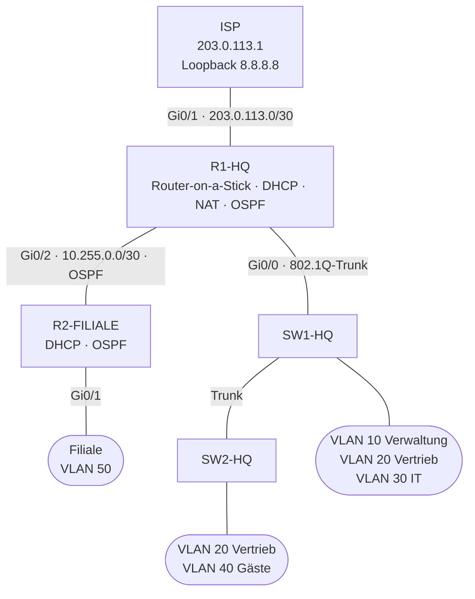

# Netzwerk-Lab mit Cisco IOS

Ein kleines Firmennetz mit **Zentrale und Filiale** – komplett als Cisco-IOS-Konfiguration für **Packet Tracer**, GNS3 oder Cisco Modeling Labs. Es deckt die Netzwerkthemen ab, die ich in der Umschulung (CCNA-Inhalte) gelernt habe: VLANs, Trunks, Inter-VLAN-Routing, DHCP, NAT, OSPF, ACLs und Härtung von Switches und Routern.

## Topologie

Benötigte Geräte in Packet Tracer: 3 × Router **2911**, 2 × Switch **2960-24TT**, einige PCs.

## Adressplan

| VLAN | Name | Netz | Gateway | DHCP |
|---|---|---|---|---|
| 10 | Verwaltung | 10.10.10.0/24 | 10.10.10.1 | ab .11 |
| 20 | Vertrieb | 10.10.20.0/24 | 10.10.20.1 | ab .11 |
| 30 | IT | 10.10.30.0/24 | 10.10.30.1 | ab .11 |
| 40 | Gäste | 10.10.40.0/24 | 10.10.40.1 | ab .11 |
| 99 | Management | 10.10.99.0/24 | 10.10.99.1 | – (SW1 .11, SW2 .12) |
| 998 | Ungenutzt | – | – | ungenutzte Ports |
| 999 | Native | – | – | nur als Native VLAN auf Trunks |
| – | Filiale | 10.20.50.0/24 | 10.20.50.1 | ab .11 (R2) |
| – | Transfer R1–R2 | 10.255.0.0/30 | – | – |
| – | Internet | 203.0.113.0/30 | 203.0.113.1 | – |

Alle Adressen stammen aus privaten bzw. Dokumentations-Bereichen (RFC 1918, RFC 5737).

## Umgesetzte Funktionen

**Switching**
- VLANs je Abteilung, 802.1Q-Trunks mit festgelegter Liste erlaubter VLANs
- Native VLAN auf ein ungenutztes VLAN (999) verlegt, DTP abgeschaltet (`nonegotiate`)
- Rapid PVST+, PortFast und **BPDU Guard** auf allen Endgeräte-Ports
- **Port-Security** (max. 2 MAC-Adressen, sticky) in Verwaltung und Vertrieb
- ungenutzte Ports abgeschaltet und in ein totes VLAN (998) verschoben

**Routing**
- Inter-VLAN-Routing per **Router-on-a-Stick**
- **DHCP** für alle Client-VLANs auf R1 bzw. für die Filiale auf R2
- **NAT/PAT** aller internen Netze auf die öffentliche Adresse
- **OSPF** (Area 0) zwischen Zentrale und Filiale, Standardroute wird per `default-information originate` an die Filiale verteilt; LAN-Schnittstellen passiv

**Sicherheit**
- **Gäste-ACL:** Gäste erreichen nur das Internet, keine internen Netze
- Verwaltung nur per **SSH v2** und nur aus IT- und Management-Netz (`access-class`)
- lokale Benutzer mit `secret`, Mindestlänge für Kennwörter, `service password-encryption`
- Schutz gegen Brute Force: `login block-for 120 attempts 3 within 60`
- Sitzungs-Timeouts auf Konsole und VTY, Warnbanner

## Verwendung

1. Topologie in Packet Tracer aufbauen (Verkabelung siehe Diagramm).
2. Auf jedem Gerät in die CLI wechseln und die passende Datei aus [`configs/`](configs/) einfügen.
3. PCs auf **DHCP** stellen.

> Die Konfigurationen verwenden das Lab-Kennwort `ChangeMe!Lab2026`. Für alles außerhalb einer Übungsumgebung unbedingt ändern.

## Testen

| Test | Befehl / Aktion | Erwartung |
|---|---|---|
| DHCP | PC in VLAN 20 auf DHCP stellen | Adresse aus 10.10.20.0/24 |
| Inter-VLAN | Ping von Vertrieb (VLAN 20) nach IT (VLAN 30) | erfolgreich |
| Internet / NAT | Ping auf `8.8.8.8`, danach auf R1 `show ip nat translations` | erfolgreich, Übersetzung sichtbar |
| OSPF | auf R2 `show ip ospf neighbor` und `show ip route` | Nachbar FULL, Default-Route `O*E2` |
| Filiale → Internet | Ping von Filial-PC auf `8.8.8.8` | erfolgreich (über R1) |
| Gäste-ACL | Ping von Gast-PC auf 10.10.10.x / 8.8.8.8 | intern blockiert, Internet erfolgreich |
| SSH-Beschränkung | `ssh -l admin 10.10.99.11` von PC in VLAN 30 bzw. VLAN 20 | aus IT erlaubt, aus Vertrieb abgelehnt |
| Port-Security | dritten PC an einen Vertriebsport hängen | `show port-security interface fa0/9`: Verstoß gezählt |

Nützliche `show`-Befehle: `show vlan brief`, `show interfaces trunk`, `show ip interface brief`, `show ip dhcp binding`, `show access-lists`, `show spanning-tree summary`.

## Lizenz

[MIT](LICENSE)
